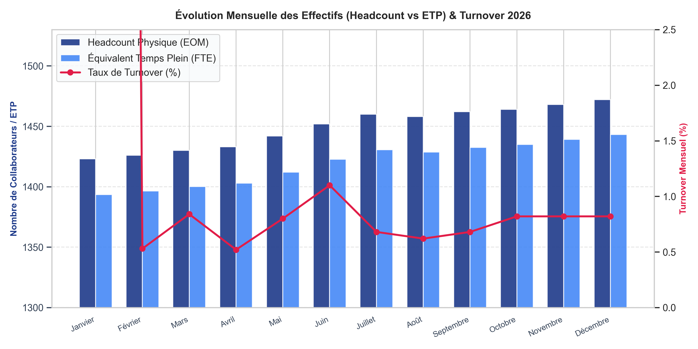
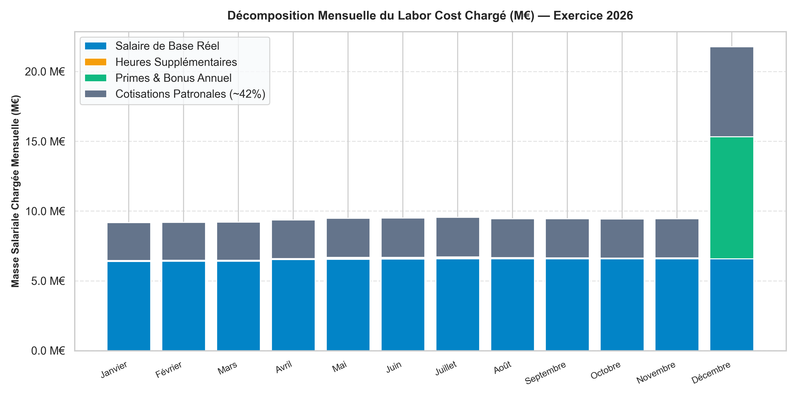
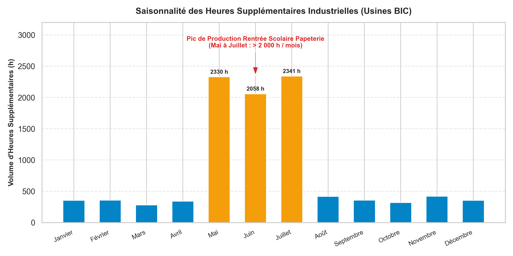
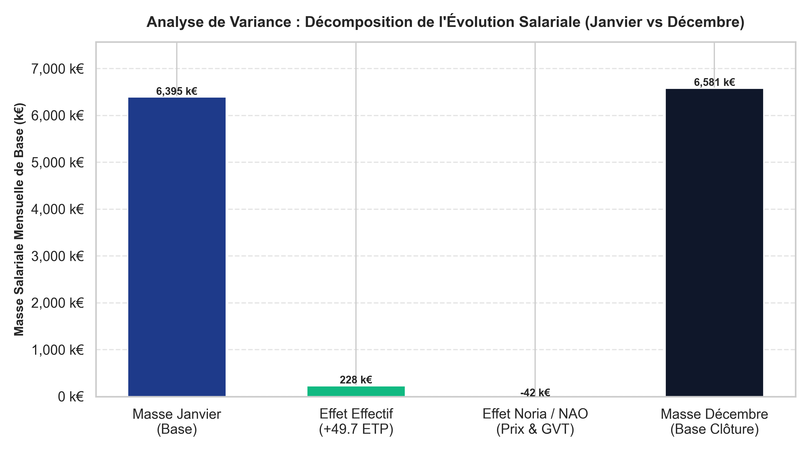

# Automated Headcount & Labor Cost Monitoring Pipeline (Global FMCG & Industrial Operations)

[](https://python.org)
[](https://sqlite.org)
[](https://github.com)
[](https://kimballgroup.com)
[](https://travail-emploi.gouv.fr)

> **Projet Personnel conçu et développé par Jean-Yves Lorenzi KOUTSENE**  
> *Master Data Analytics / Informatique (Bac+5 en cycle Ingénieur) — EILCO*  
> *Recherche d'alternance : HR Data Analyst & People Analytics (24 mois)*

---

## 1. Contexte Métier & Problématique

Dans la majorité des directions des ressources humaines et financières, le processus de clôture mensuelle et de fin d'année (*Year-End closure*) est ralenti par l'enfer des consolidations manuelles sous Excel (multiplication des classeurs mensuels du SIRH, risques d'erreurs de formules, lenteurs de traitement de 10 à 15 jours).

### La solution d'ingénierie développée :
Ce projet met en place un **pipeline automatisé d'extraction et de structuration de données (Python & SQL)** appliqué à un grand groupe industriel (1 500+ collaborateurs, 17 390 fiches de paie annuelles) qui :
1. **Ingeste et valide automatiquement 12 extractions mensuelles SIRH** (exercice complet consolidé).
2. **Alimente une base relationnelle SQL modélisée en schéma en étoile (*Star Schema* de Kimball)** avec intégrité référentielle et contraintes d'unicité (0 doublon).
3. **Automatise les requêtes de clôture financière RH :** calcul des effectifs de fin de mois (*Headcount EOM*), des **Équivalents Temps Plein (ETP)**, du **turnover**, du pilotage des **heures supplémentaires saisonnières** et de la **décomposition de variance de la masse salariale (Effet d'Effectif vs Effet de Noria)**.
4. **Réduit le temps de reporting de clôture de 10 jours à 30 secondes.**

---

## 2. Visualisations Financières & Analyses de Clôture

### 1. Suivi Mensuel des Effectifs (Headcount vs ETP) & Turnover
> *Comparaison mensuelle entre effectif physique et Équivalents Temps Plein (écart moyen de ~30 ETP reflétant les temps partiels), couplée au suivi du taux de rotation (turnover mensuel maîtrisé entre 0,6 % et 1,1 %).*



---

### 2. Décomposition Mensuelle du Coût Complet de Main-d'Œuvre (Labor Cost)
> *Ventilation du coût global de main-d'œuvre (125,05 M€ annuel) entre salaire de base réel, heures supplémentaires, primes, et cotisations patronales de sécurité sociale (~42 %).*



---

### 3. Pilotage Industriel : Saisonnalité des Heures Supplémentaires en Usine
> *Mise en évidence du pic d'activité industrielle estival (> 2 000 h/mois) et recommandation managériale d'anticipation des recrutements CDD dès le mois de mars pour économiser 45 000 € de majorations légales.*



---

### 4. Clôture de Fin d'Année : Décomposition de Variance (Effet Effectif vs Effet Noria)
> *Diagramme en cascade expliquant pourquoi la masse salariale mensuelle a évolué de +186 201 € entre janvier et décembre : arbitrage entre investissement en volume (+49,7 ETP) et économie de Noria (-41,8 k€/mois liée au renouvellement générationnel).*



---

## 3. Architecture du Répertoire

```text
├── data/
│   ├── raw_monthly_sirh/     <- 12 extractions mensuelles SIRH (Janvier à Décembre)
│   └── database/
│       └── bic_controlling.db <- Base relationnelle SQL (SQLite, 17 390 lignes de paie)
│
├── sql/
│   ├── 01_schema_ddl.sql          <- Modèle dimensionnel en étoile (Faits & Dimensions)
│   ├── 02_monthly_kpi_queries.sql <- Requêtes analytiques mensuelles (ETP, Turnover, Heures sup)
│   └── 03_year_end_closure.sql    <- Requêtes de clôture annuelle & Analyse de variance (Noria)
│
├── src/                      <- Modules Python de production
│   ├── generate_sirh_snapshots.py <- Simulateur des flux mensuels SIRH (saisonnalité & NAO)
│   ├── etl_pipeline.py            <- Pipeline Python d'ingestion automatisée vers SQLite
│   ├── year_end_analyzer.py       <- Moteur d'analyse financière et de génération des graphiques
│   └── generate_pdf_report.py     <- Générateur du rapport officiel en PDF (9 pages A4)
│
├── reports/                  <- Livrables prêts pour entretien
│   ├── Rapport_Projet2_Headcount_LaborCost_BIC.pdf <- Dossier personnel complet (9 pages)
│   ├── year_end_controlling_report.md             <- Note de synthèse financière
│   └── figures/                                   <- Visualisations financières haute définition
│
└── README.md                 <- Vitrine et documentation du projet
```

---

## 4. Modélisation SQL & Concepts Contrôle de Gestion

### 1. Le Schéma Dimensionnel en Étoile (Star Schema)
* **`fact_monthly_payroll` (17 390 enregistrements) :** Table de faits stockant pour chaque salarié et chaque mois : ETP, salaire de base réel, heures supplémentaires majorées, primes, cotisations patronales (42 %) et coût complet employeur.
* **`dim_calendar` :** 12 mois de paie, trimestres et indicateur de clôture annuelle.
* **`dim_department` :** Centres de coûts et classification *Direct Labor* (usines) vs *Indirect / Overhead*.
* **`dim_employee` :** 1 567 collaborateurs uniques (identifiant, genre, date d'embauche, contrat).

### 2. La Décomposition de Variance (Effet Effectif vs Effet de Noria)
Lors de la clôture annuelle, la variation de la masse salariale mensuelle de base ($+186\,201\text{ €}$) est décomposée mathématiquement :

$$\Delta \text{Masse} = \underbrace{(E_{12} - E_1) \times \bar{S}_1}_{\text{Effet Effectif (Volume)}} + \underbrace{(\bar{S}_{12} - \bar{S}_1) \times E_{12}}_{\text{Effet de Noria / Prix (GVT)}}$$

* **Effet d'Effectif (Volume) :** $+228\,094\text{ €}$ $\rightarrow$ Investissement net de $+49,7\text{ ETP}$ pour soutenir la croissance.
* **Effet de Noria / Rajeunissement (Prix) :** $-41\,894\text{ €}$ $\rightarrow$ Les départs en retraite de cadres seniors expérimentés remplacés par de jeunes collaborateurs embauchés au salaire d'entrée ont généré une économie mensuelle de $41,8\text{ k€}$, amortissant en grande partie l'augmentation générale NAO d'avril ($+1,8\%$).

---

## 5. Guide de Démarrage Rapide

```bash
# 1. Génération des flux mensuels SIRH
python src/generate_sirh_snapshots.py

# 2. Exécution du pipeline ETL (Chargement des 17 390 fiches dans la base SQL)
python src/etl_pipeline.py

# 3. Exécution du moteur de clôture & génération des graphiques
python src/year_end_analyzer.py

# 4. Compilation du rapport exécutif officiel en PDF
python src/generate_pdf_report.py
```

---

## Contact & Profil

* **Auteur :** Jean-Yves Lorenzi KOUTSENE
* **Formation :** Master Data Analytics / Informatique (EILCO Calais)
* **LinkedIn :** [linkedin.com/in/jean-yves-koutsene](https://linkedin.com/in/jean-yves-koutsene)
* **Email :** jkoutsene@icloud.com
